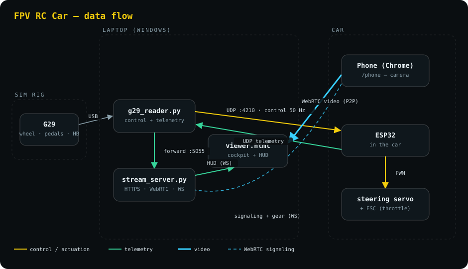

# FPV RC Car — drive a real RC car from a sim-racing rig

Drive a physical RC car with a Logitech G29 wheel, pedals and handbrake, while
watching a live first-person video feed from a phone mounted in the car, with a
telemetry HUD over the picture. Shift into reverse and the feed flips to the
phone's other camera automatically. The goal: a backyard RC car that feels like
sitting in the driver's seat.

**No IP addresses to configure.** The laptop finds the car on whatever network
it's on, and the phone connects by scanning a QR code on the cockpit screen.



## Quick start

```bash
pip install -r requirements.txt
python launch.py
```

1. Power the car. Put the laptop on the same WiFi as the car.
2. `python launch.py` finds the car and opens the cockpit in your browser.
3. On the phone in the car, scan the QR code on the cockpit → **Start streaming**.

That's it. If something doesn't connect: `python launch.py --doctor`.

## How it works

Two independent data paths share one laptop:

- **Control + telemetry** (UDP): `rccar/g29_reader.py` reads the wheel and sends a
  50 Hz binary packet (steering, throttle, brake, handbrake, gear, trim) to the
  ESP32 in the car, which drives the steering servo and ESC and streams
  telemetry back at 10 Hz. The reader forwards telemetry to the stream server.
- **Video** (WebRTC): the phone sends its camera peer-to-peer to the laptop
  browser. `rccar/stream_server.py` only brokers the connection, serves the
  pages over HTTPS (phones require it for camera access) and fans telemetry out
  to the HUD over a WebSocket.

### Finding the car (no fixed IP)

The car answers any valid control packet with telemetry, so the reader sends a
**neutral** packet everywhere the car might be and locks onto whoever answers.
Every method runs in parallel:

| Method | Works when |
|---|---|
| last known IP (`.rccar/car.json`) | the car kept its address — instant |
| mDNS `rc-car.local` | the router passes multicast (most do) |
| Windows resolver `rc-car.local` | Windows 10+ mDNS |
| UDP broadcast on every LAN interface | always on a normal home/hotspot network |
| `--car-ip` / `RC_CAR_IP` | you want to force one (optional) |

If telemetry goes silent for 3 s (reboot, new DHCP lease, out of range), the
reader goes back to searching — sending only neutral probes, never stale
steering — and re-locks the moment the car answers, at whatever IP it has now.
VPN adapters (Tailscale) and link-local addresses are ignored.

### Connecting the phone (no fixed IP)

The cockpit page shows a QR code for the phone URL, picking the laptop address
on the **car's** subnet (the launcher prints the same QR code in the terminal).
HTTPS uses a private certificate authority created on first run: install
`/ca.crt` on the phone once and the certificate warning is gone on every
network; otherwise tap *Advanced → Proceed* as before.

## Repo layout

```
launch.py                one command: server + wheel reader, restarts, cleanup
rccar/                   laptop side (Python)
  g29_reader.py          wheel -> car control loop, telemetry, drive logs
  stream_server.py       HTTPS + WebRTC signaling + telemetry fan-out + QR
  discovery.py           finds the car (cache / mDNS / resolver / broadcast)
  mdns.py                tiny dependency-free mDNS client
  netinfo.py             laptop interfaces: Wi-Fi vs Ethernet vs VPN
  certs.py               local CA + auto re-issued server certificate
  protocol.py            packet formats (keep in sync with the firmware)
  config.py              settings, all env-overridable (no IPs)
  web/viewer.html        cockpit: video + HUD + phone QR + video diagnostics
  web/phone.html         phone: camera capture, lens/quality, reverse switch
firmware/car_link_rx/    ESP32 sketch (see firmware/README.md)
tools/
  flash.py               build + OTA-flash the car (finds it automatically)
  doctor.py              network diagnosis (python launch.py --doctor)
  find_car.py            where is the car / what firmware is it running
  analyze_log.py         root-cause a drive log (reboots, freezes, RF, laptop)
  sim_car.py             fake car for testing without hardware
docs/                    hardware, protocol, troubleshooting, project history
```

## Common tasks

| Task | Command |
|---|---|
| Drive | `python launch.py` |
| Something won't connect | `python launch.py --doctor` |
| Where's the car? | `python tools/find_car.py` |
| Flash new firmware (OTA) | `python tools/flash.py` |
| Why did the last drive glitch? | `python tools/analyze_log.py` |
| Work on the UI without the car | `python tools/sim_car.py` + `python launch.py` |
| Full-screen terminal HUD | `python -m rccar.g29_reader` |

## Configuration

Nothing needs configuring. Optional overrides (environment variables):

| Setting | Env var | Default |
|---|---|---|
| Car IP to try first | `RC_CAR_IP` (or `--car-ip`) | discovered |
| Car mDNS hostname | `RC_CAR_HOST` | `rc-car` |
| Car UDP port | `RC_CAR_PORT` | `4210` |
| Control rate (Hz) | `RC_SEND_HZ` | `50` |
| Silence before re-search (s) | `RC_CAR_LOST_S` | `3` |
| HTTPS port | `RC_HTTPS_PORT` | `8443` |
| Reader → server telemetry port | `RC_TELE_PORT` | `5055` |

Wheel calibration (axis indices, steering endpoints, gear buttons, trim d-pad)
lives at the top of `rccar/g29_reader.py`. The standalone HUD
(`python -m rccar.g29_reader`) shows a live button/hat probe to help remap a
different wheel.

## ⚠️ The car's ESP32 has a dead USB port

It can only be flashed over WiFi. Firmware 2.x uses the bootloader's app
rollback: a new image must prove it can rejoin WiFi and keep OTA running for
20 s, or the car reverts to the previous firmware by itself. Use
`tools/flash.py` (it checks and reports all of this). Details:
[firmware/README.md](firmware/README.md).

## More

- [Hardware, wiring and power](docs/hardware.md)
- [Wire protocol](docs/protocol.md)
- [Troubleshooting](docs/troubleshooting.md), including every problem hit so far
- [Project history and roadmap](docs/history.md)

## License

MIT — see [LICENSE](LICENSE).
